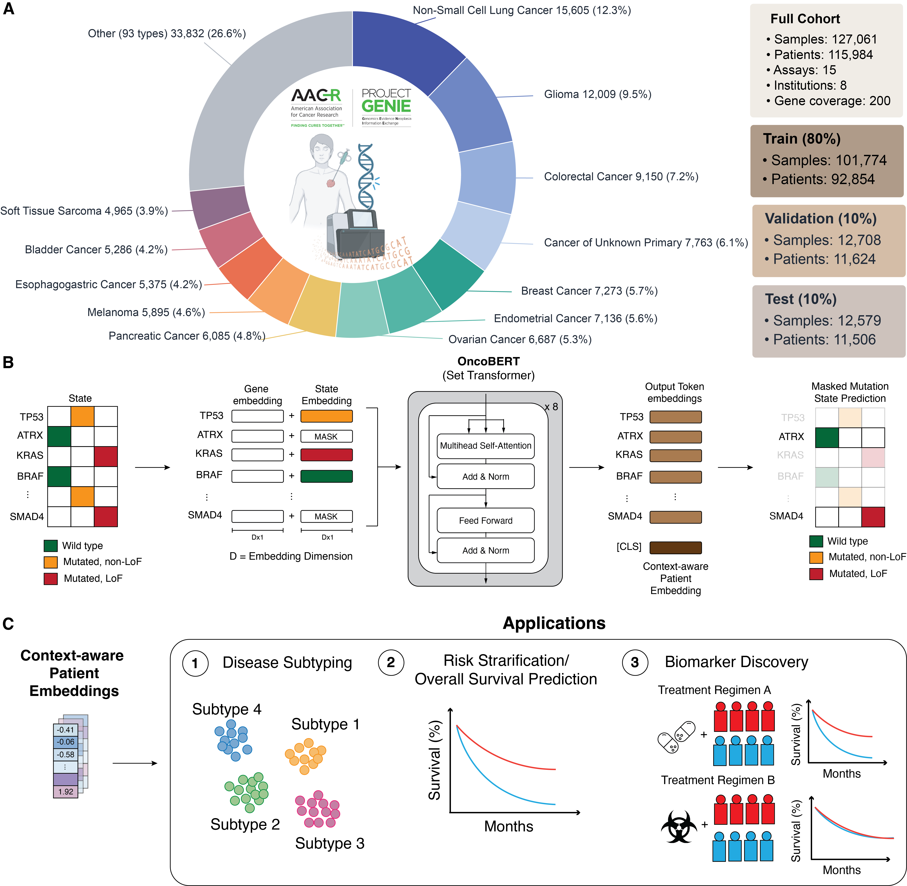

# OncoBERT
OncoBERT is a general-purpose foundation model that learns broad contextual representations of somatic mutations through self-supervised learning on massive unlabeled genomic sequencing datasets.  

<br><br>

<div align="center">
  
</div>


## Model

Every sample contains the same set of 200 commonly profiled
genes. For gene `g`, the input token is

```text
learned gene-identity embedding(g) + learned mutation-state embedding(g)
```

The three mutation states are:

```text
0  WILD_TYPE
1  MUTATED_NOT_LOF
2  LOF
```

During pretraining, 15% of state IDs (30 of 200 genes) are replaced by an
input-only MASK embedding. Gene identity remains visible. Eight Transformer
encoder layers predict the held-out states with unweighted cross-entropy. No
positional embeddings are used. The final CLS vector is the sample
representation; a patient representation is the mean of all corresponding
sample-level CLS vectors.

Default architecture:

| Setting | Value |
|---|---:|
| Genes | 200 |
| Mutation states | 3 |
| Embedding dimension | 128 |
| Transformer layers | 8 |
| Attention heads | 8 |
| Feed-forward dimension | 2,048 |
| Dropout | 0.1 |
| Mask fraction | 0.15 |

## Repository layout

```text
oncobert/model.py                 OncoBERT set transformer implementation
oncobert/utils.py                 shared I/O and pooling utilities
oncobert/training.py              masked mutation-state pretraining implementation
oncobert/inference.py             sample/patient embedding inference
oncobert/rank_encoder.py          diffusion-rank ablation architecture
oncobert/train_rank_encoder.py    rank-objective pretraining CLI
prepare_set_transformer_data.py   prepare splits and fixed evaluation masks
train.py                          mutation-state pretraining CLI
inference.py                      embedding inference CLI
saved_checkpoints/                released pretrained weights
baselines/                        MutationProjector and NMF baselines
benchmarks/                       GENIE, TCGA, CHORD, and ICI benchmarks
ablations/                        rank and embedding-dimension studies
biomarker_discovery/              treatment interaction and interpretation
data/                             vocabulary, manifests, and download tools
```

## Installation

Python 3.10 and PyTorch 2.7 were used for the final experiments.

```bash
git clone https://github.com/spatkar94/OncoBERT.git
cd OncoBERT
conda create -n oncobert python=3.10 -y
conda activate oncobert
pip install -r requirements.txt
```

Install the additional graph dependency for MutationProjector and the complete
analysis collection:

```bash
pip install -r requirements-analysis.txt
```

## Pretrained model

The final shared-200 checkpoint and its exact gene order are distributed in the
repository:

```text
saved_checkpoints/oncobert_set_transformer_shared200_dim128.pth
data/shared200_genes.txt
```

The checkpoint stores the architecture, model weights, ordered genes,
validation metrics, and training configuration. Loading is strict:

```python
from oncobert import OncoBERT

model, checkpoint = OncoBERT.from_checkpoint(
    "saved_checkpoints/oncobert_set_transformer_shared200_dim128.pth"
)
model.eval()
```

## Input data

OncoBERT expects a NumPy array with shape `samples × 200 genes`. Columns must
match `data/shared200_genes.txt`; values must be `0`, `1`, or `2` as defined
above. Functional annotation of raw variants is upstream of the encoder. The
manuscript used LoGoFunc together with mutation-class rules to define LOF.

Sample metadata is a CSV containing:

```csv
sample_id,patient_id
SAMPLE_001,PATIENT_001
SAMPLE_002,PATIENT_001
SAMPLE_003,PATIENT_002
```

Multiple samples from one patient are allowed. They are kept in the same data
split and averaged only when a patient-level representation is requested.

### Prepare patient-disjoint splits

```bash
python prepare_set_transformer_data.py \
  --states functional_states.npy \
  --metadata sample_metadata.csv \
  --genes data/shared200_genes.txt \
  --output prepared/shared200
```

This validates the matrix, creates patient-disjoint 80/10/10
training/validation/test splits, and generates fixed 15% masks for validation
and testing. The prepared directory contains:

```text
functional_states.npy
profiles.npz
validation_masks.npz
test_masks.npz
preparation_summary.json
```

## Pretraining

```bash
python train.py \
  --prepared prepared/shared200 \
  --output runs/oncobert \
  --device cuda:0 \
  --epochs 100 \
  --batch-size 64
```

Important defaults reproduce the final protocol: dimension 128, eight layers,
eight heads, 15% uniform masking, AdamW with learning rate `1e-4`, and early
stopping on fixed-mask validation cross-entropy. Use `--resume` to continue
from `latest.pth`.

The run directory contains:

```text
best.pth                  minimum validation-loss checkpoint
latest.pth                resumable training state
config.json               architecture and protocol
history.json              epoch history
epoch_metrics.csv         tabular learning curves
test_metrics.json         held-out reconstruction metrics
embeddings.h5             sample CLS and patient-mean representations
pretraining_summary.json  final run summary
```

Reported reconstruction metrics include three-state macro AUPRC, state top-1
accuracy, balanced accuracy, binary mutation micro AUPRC, and per-gene binary
macro AUPRC.

## Inference

```bash
python inference.py \
  --states functional_states.npy \
  --metadata sample_metadata.csv \
  --checkpoint saved_checkpoints/oncobert_set_transformer_shared200_dim128.pth \
  --output oncobert_embeddings.h5 \
  --device cuda:0
```

The output stores unmasked sample CLS embeddings, patient-level means, patient
sample counts, sample/patient identifiers, and the checkpoint gene order.

## Diffusion-rank ablations

The three rank encoders share the OncoBERT backbone but replace mutation-state
targets with ranks precomputed by diffusion over weighted ESM2, GenePT, or
STRING networks. Each row of the rank matrix must be a complete permutation of
`1..200` (or zero-based `0..199`).

### External network resources

The external embedding and interaction files are not committed because of
their size. Download them from their original providers:

| Rank network | Resource | Manuscript input |
|---|---|---|
| ESM2 | [ESM Metagenomic Atlas bulk-download instructions](https://github.com/Biohub/esm-archive/blob/main/scripts/atlas/README.md) | Mean-pooled, 1,280-dimensional ESM2 protein vectors aligned to gene symbols |
| GenePT | [GenePT embeddings, Zenodo record 10833191](https://zenodo.org/records/10833191) | `GenePT_gene_embedding_ada_text.pickle` |
| STRING | [STRING human downloads](https://string-db.org/cgi/download?species=Homo+sapiens) | Human physical links and protein-to-gene metadata |

#### ESM2

The ESM Atlas repository provides URL manifests under
`scripts/atlas/v2023_02/full/esm2_embeddings/` and recommends `aria2c` or
`s5cmd` for bulk transfer. For example:

```bash
git clone https://github.com/Biohub/esm-archive.git external/esm-archive
cd external/esm-archive/scripts/atlas
aria2c \
  --dir=/path/to/esm2_atlas \
  --input-file=v2023_02/full/esm2_embeddings.txt
```

Atlas records use protein-sequence identifiers rather than HGNC gene symbols.
Map each shared-200 gene to its canonical protein sequence before selecting an
embedding. The manuscript cache used one finite, nonzero 1,280-dimensional
vector per gene in the exact order of `data/shared200_genes.txt`. If a canonical
human sequence is absent from the Atlas, generate its mean-pooled embedding
with the corresponding 1,280-dimensional ESM2 model rather than substituting a
different gene or isoform.

#### GenePT

Download and unpack the version-2 Zenodo archive:

```bash
mkdir -p external/genept
wget -O external/genept/GenePT_emebdding_v2.zip \
  'https://zenodo.org/records/10833191/files/GenePT_emebdding_v2.zip?download=1'
unzip external/genept/GenePT_emebdding_v2.zip -d external/genept
```

Use `GenePT_gene_embedding_ada_text.pickle`, whose dictionary keys are
upper-case gene symbols. Select the 200 shared genes in vocabulary order and
fail rather than silently imputing a missing gene.

#### STRING

For exact manuscript provenance, use the
[archived STRING v12.0 download page](https://version-12-0.string-db.org/cgi/download?species=Homo+sapiens);
the current STRING page may expose a newer version. Download:

```text
9606.protein.physical.links.v12.0.txt.gz
9606.protein.info.v12.0.txt.gz
```

The first file supplies physical protein links and `combined_score`; the second
maps STRING protein IDs to preferred gene names. Restrict both endpoints to the
shared-200 vocabulary, collapse duplicate protein-level links to a gene pair by
their maximum score, use `combined_score / 1000` as an undirected edge weight,
remove self-edges, and retain unmapped genes as isolates. No additional STRING
confidence threshold was applied in the final weighted-network experiment.

### From external resources to rank matrices

For ESM2 and GenePT, L2-normalize the aligned gene vectors and construct the
undirected adjacency matrix

```text
W[i,j] = max(cosine(embedding[i], embedding[j]), 0),  i != j
W[i,i] = 0
```

For all three networks, symmetrically normalize the adjacency,
`S = D^(-1/2) W D^(-1/2)`, and run random walk with restart from each sample's
binary nonsynonymous mutation profile:

```text
f(t+1) = 0.5 * S * f(t) + 0.5 * mutation_profile
```

Rank all 200 genes by decreasing converged diffusion score. Resolve exact ties
stably in `data/shared200_genes.txt` order. Save the resulting samples-by-200
integer matrix as `esm2_ranks.npy`, `genept_ranks.npy`, or
`string_ranks.npy`. Network resources determine the rank targets only; they are
not loaded by `train_rank_encoder.py`, which deliberately consumes the frozen,
auditable rank matrix.

### Rank-encoder pretraining

```bash
python -m oncobert.train_rank_encoder \
  --prepared prepared/shared200 \
  --ranks prepared/shared200/esm2_ranks.npy \
  --network esm2 \
  --output runs/rank_esm2 \
  --device cuda:0
```

Set `--network genept` or `--network string` with the corresponding precomputed
rank matrix. The script logs masked-rank cross-entropy, top-1/top-5/top-10 rank
accuracy, MAE, RMSE, and CLS embeddings. It also exports unmasked sample CLS
embeddings and patient means to `embeddings.h5`, so a completed pretraining run
already performs inference on every prepared sample.

### Rank-encoder inference on another cohort

Construct the new cohort's binary nonsynonymous shared-200 profiles and compute
ranks with the *same* saved network, restart probability, gene order, and tie
policy used for pretraining. Load `best.pth` strictly and pass zero-based ranks
to the model:

```python
import numpy as np
import torch
from oncobert.rank_encoder import RankEncoder

checkpoint = torch.load("runs/rank_esm2/best.pth", map_location="cpu",
                        weights_only=True)
model = RankEncoder(**checkpoint["architecture"])
model.load_state_dict(checkpoint["model_state_dict"], strict=True)
model.eval()

ranks = np.load("new_cohort_esm2_ranks.npy", allow_pickle=False)
if ranks.min() == 1:              # convert 1..200 to model IDs 0..199
    ranks = ranks - 1
with torch.inference_mode():
    _, sample_embeddings = model(torch.from_numpy(ranks).long())
```

Average `sample_embeddings` only when patient-level inference is required and a
patient has multiple eligible baseline samples. Do not recompute or refit the
network on an evaluation cohort.

## Manuscript analyses

Each analysis directory contains a README describing its inputs and command.
The complete figure-to-script map is
`data/manifests/figure_workflows.json`. Large or access-controlled raw cohorts
are not redistributed; acquisition and environment variables are documented
in `data/README.md` and `data/datasets.json`.

Download public cBioPortal studies with:

```bash
python data/download_cbioportal.py --extract
```

Verify source compilation, required assets, the checkpoint architecture, and
the ordered gene vocabulary with:

```bash
python verify_repository.py
python -m unittest -v tests.test_set_transformer
```

## Citation

```bibtex
@article{Patkar2026OncoBERT,
  author = {Patkar, Sushant and Auslander, Noam and Harmon, Stephanie and
            Choyke, Peter and Turkbey, Baris},
  title = {OncoBERT: Context-Aware Modeling of Somatic Mutations for Precision Oncology},
  year = {2026},
  doi = {10.64898/2026.02.18.706658},
  journal = {bioRxiv}
}
```

Questions and issues: [patkar.sushant@nih.gov](mailto:patkar.sushant@nih.gov)
