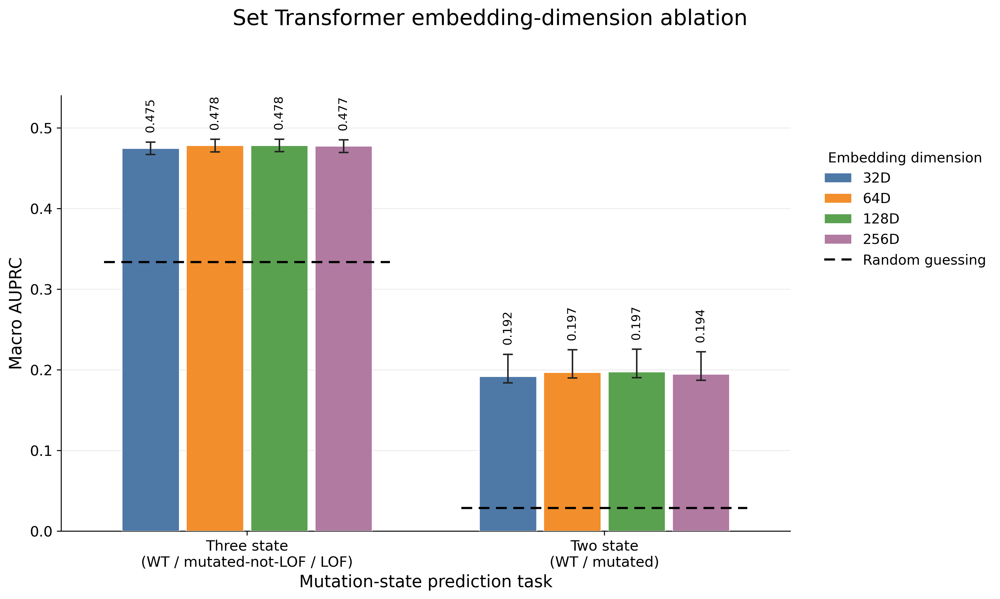

# Embedding-dimension ablation

## Ablation overview

The figure below compares held-out masked-state reconstruction across 32-,
64-, 128-, and 256-dimensional OncoBERT models using both the original
three-state target and the collapsed WT-versus-mutated target.

  

`collect_metrics.py` gathers dimension-specific checkpoints,
`compute_bootstrap.py` calculates patient-resampling confidence intervals, and
`build_figure.py` plots three-state and WT-versus-mutated macro AUPRC for 32,
64, 128, and 256 dimensions.

Final reference: `data/example_outputs/ablation_embedding_dimension.png`.
