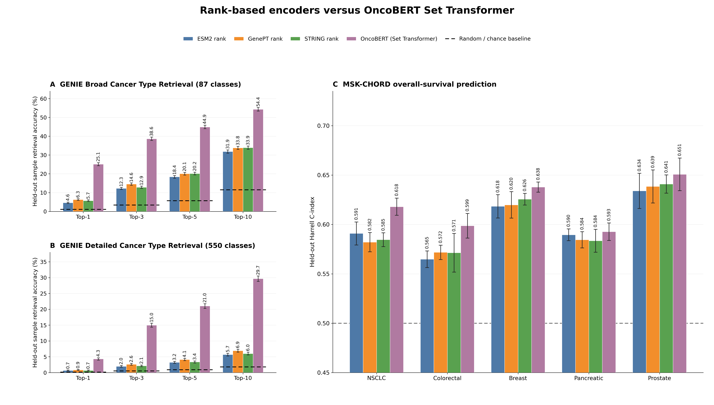

# Rank versus set encoder

## Ablation overview

The composite below compares the ESM2-, GenePT-, and STRING-derived diffusion
rank encoders with the OncoBERT Set Transformer on GENIE broad and detailed
cancer-type retrieval and MSK-CHORD overall-survival prediction.

  

`export_rank_embeddings.py` exports full-context rank-encoder representations,
`compute_retrieval_bootstrap.py` recomputes sample-level top-k retrieval with
patient-resampled confidence intervals, and `build_figure.py` combines broad
retrieval, detailed retrieval, and CHORD OS.

Final reference: `data/example_outputs/ablation_rank_vs_set.png`.
