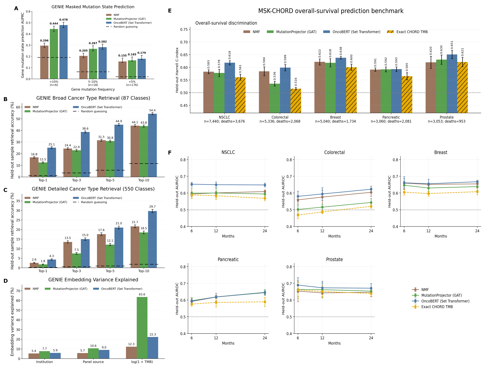

# GENIE retrieval and MSK-CHORD OS composite

## Benchmark overview

The composite below compares OncoBERT with the NMF and MutationProjector
baselines across masked mutation-state prediction, GENIE broad and detailed
cancer-type retrieval, and MSK-CHORD overall-survival prediction.

  

The pipeline comprises:

1. `plot_mutation_retrieval.py`: masked WT-versus-mutated AUPRC by mutation
   frequency bin for NMF, MutationProjector, and OncoBERT.
2. `benchmark_broad_retrieval.py`: sample-level retrieval of 87 standardized
   GENIE broad cancer labels.
3. `benchmark_detailed_retrieval.py`: sample-level retrieval of 550 OncoTree
   lineage labels, with labels supported by fewer than five samples grouped as
   `Other`.
4. `benchmark_chord_os.py`: nested-CV Harrell C-index and time-dependent AUROC.
5. `build_figure.py`: assembles the final six-panel figure.

The final builder reads panel artifacts below
`$ONCOBERT_WORK_ROOT/artifacts/` and writes
`artifacts/three_encoder_composite_benchmark/`.
