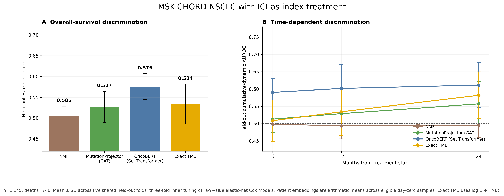

# NSCLC ICI-index overall-survival benchmark

## Benchmark overview

The composite below compares NMF, MutationProjector, and OncoBERT for
overall-survival prediction among MSK-CHORD patients with NSCLC who received
ICI as their index post-sequencing treatment.

  

`benchmark.py` compares NMF, MutationProjector, and OncoBERT representations in
MSK-CHORD patients whose index post-sequencing regimen contains an anti-PD-1 or
anti-PD-L1 agent. The benchmark uses the same nested-CV Coxnet protocol as the
pan-cancer CHORD analysis and reports Harrell C-index and 6/12/24-month AUROC.

Multiple eligible baseline specimens are encoded separately and mean-pooled to
one patient representation. Post-treatment specimens are excluded.
