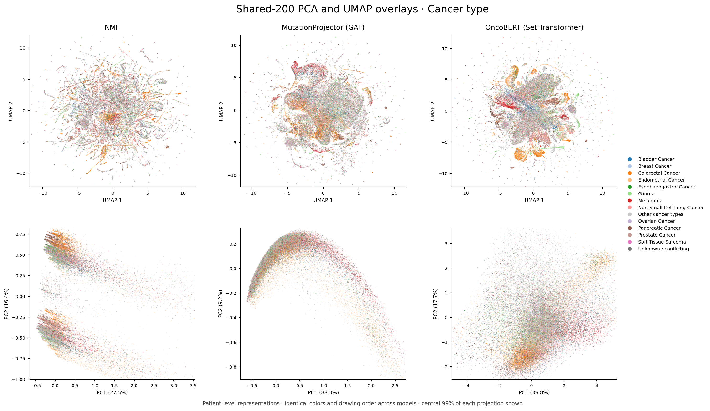
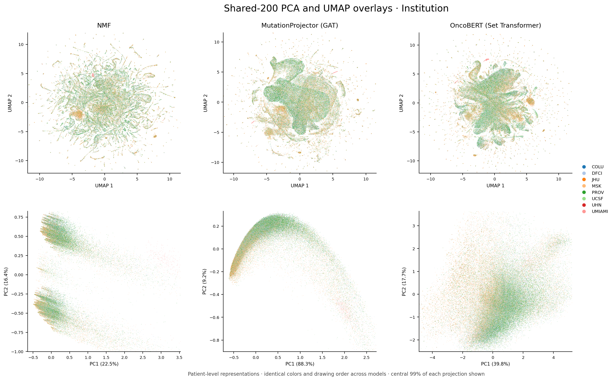
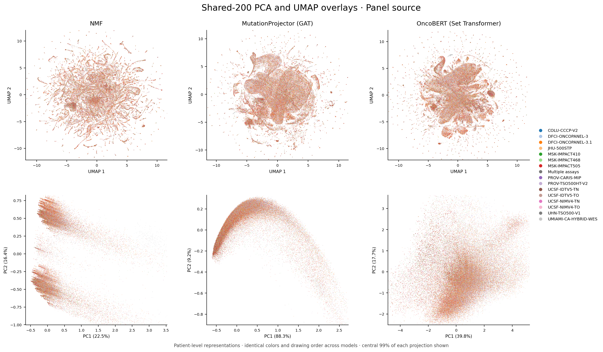

# Representation diagnostics and overlays

## Benchmark overview

The reference panels below compare the PCA and UMAP structure of the learned
representations after coloring matched patients by cancer type, institution,
and sequencing-panel source.

### Cancer type

<div align="center">
  
</div>

### Institution

<div align="center">
  
</div>

### Sequencing-panel source

<div align="center">
  
</div>

`compute_metrics.py` computes held-out covariate decoding and native embedding
variance association. `plot_overlays.py` creates PCA/UMAP panels colored by
cancer type, institution, and panel source. Supporting modules implement the
same label filtering and variance estimators used in the manuscript.

Run with an artifact workspace containing matched `patients.h5ad` files:

```bash
python benchmarks/representation_diagnostics/plot_overlays.py --help
```

The final reference panels are `data/example_outputs/overlay_*.png`.
