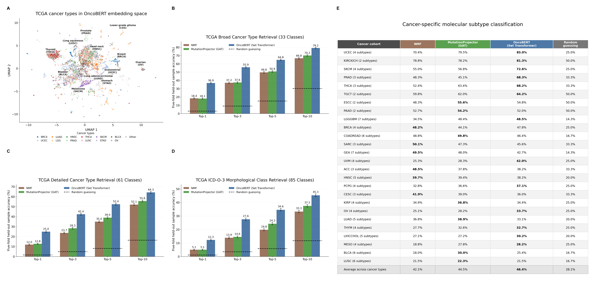

# TCGA benchmark

## Benchmark overview

The composite below compares NMF, MutationProjector, and OncoBERT on TCGA
broad and detailed cancer-type retrieval, ICD-O-3 morphology retrieval, and
within-cancer molecular-subtype classification. It also visualizes the
OncoBERT embedding space.

  

- `plot_umap.py`: OncoBERT UMAP with broad TCGA cancer labels.
- `benchmark_broad_retrieval.py`: 33 PanCanAtlas cancer-type acronyms.
- `benchmark_detailed_retrieval.py`: OncoTree lineage retrieval.
- `benchmark_icdo3_retrieval.py`: ICD-O-3 morphology retrieval.
- `render_subtype_table.py`: within-cancer molecular-subtype classification.
- `build_figure.py`: assembles the final TCGA composite.

All retrieval tasks are sample-level. Cross-validation and bootstrap resampling
remain grouped by patient so multiple aliquots cannot cross folds. Classes with
fewer than five matched samples are retained under `Other`.
