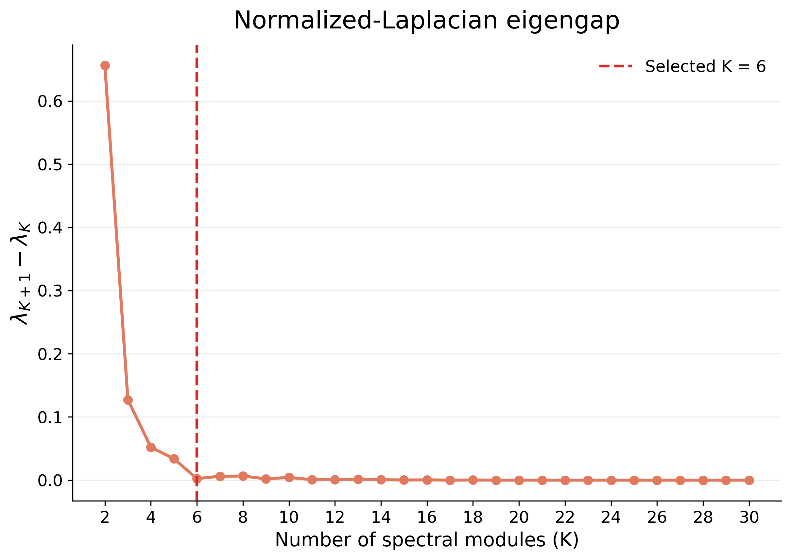

# Normalized-Laplacian eigengap

## Analysis overview

The eigengap profile below supports selection of the spectral-module count for
the Cluster 2 final-layer attention matrix.

  

`build_figure.py` reads the K-sweep table and plots the normalized-Laplacian
eigengap used to select the number of spectral attention modules.

Final reference: `data/example_outputs/biomarker_eigengap.png`.
